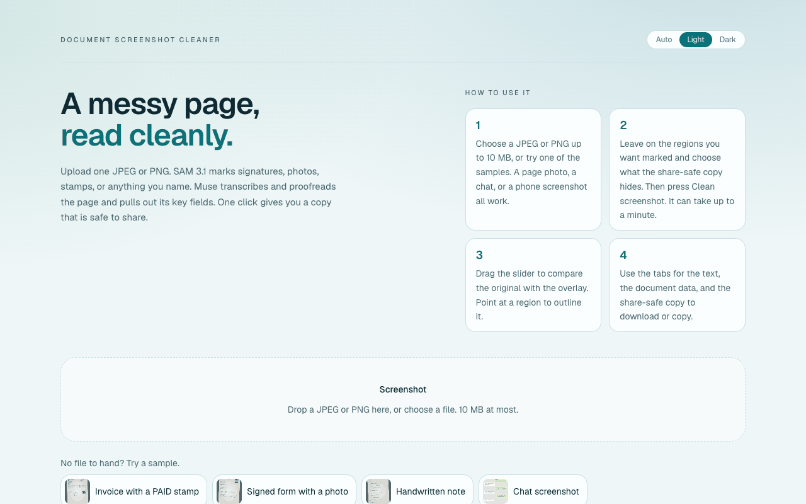
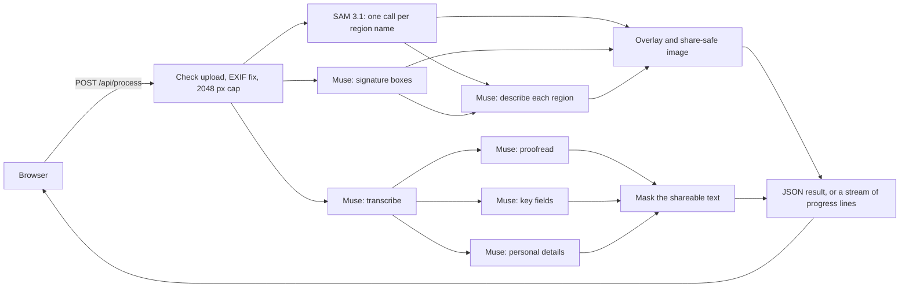

# Document screenshot cleaner

[](https://github.com/vignarajj/dsc_hackathon/actions/workflows/ci.yml)
[](LICENSE)



People photograph IDs, forms, and bank slips and send them over chat every day, signatures, faces, and account numbers included. Drop the photo in. SAM 3.1 finds the signature, the photo, the stamp, or anything you name. Muse reads the page, fixes it, pulls out the fields, and spots the phone numbers and ID numbers. One click gives you a copy that is safe to share.

It was built for the Meta Global AI Developer Hackathon, Indie track, on the theme Build for Your World.

## What you can do

1. Choose or drop a JPEG or PNG up to 10 MB, or click one of the four sample pages.
2. Choose what SAM marks: stamp, signature, photograph, rectangle, and up to 3 things you name, such as "logo" or "QR code".
3. Choose what the share-safe copy hides (signature and photograph by default), black box or blur, and whether to mask personal details in the text. Optionally pull out the document's key fields (on by default) and describe each region in a few words (off by default).
4. Press Clean screenshot. A step list shows each stage as it finishes. A request can take up to a minute. Cancel stops it on the server too. The page gives up after 180 seconds and offers Try again.
5. Read the result in four tabs:
   - **Overview**: the original and the SAM overlay under one slider. Point at a region to outline it. Download the overlay PNG.
   - **Text**: the transcription beside the proofread, with edits marked. Copy it or download Markdown. Have it read aloud. Ask the document a question and get an answer with the exact words it came from.
   - **Data**: the document type, a summary, and key fields, each marked when its value is not in the text. Download JSON or CSV.
   - **Share-safe**: the hidden copy under a before/after slider, with no location or camera data, and the text with personal details replaced by `[PHONE]`, `[NAME]`, and so on.

There is no account system, no saved history, and no multi-page document support. Nothing you upload is stored.

## What is in this repo

| Path | What it is |
|---|---|
| `backend/` | FastAPI service. Checks the image, calls the models, draws the overlay and the share-safe copy, and streams progress. |
| `backend/tests/fake_server.py` | The real API with a fixed model gateway, for browser tests. Never calls Meta. |
| `frontend/` | Next.js page. Uploads the image and shows the result in tabs. |
| `frontend/public/samples/` | Four sample pages made for this app. Names are invented; phone numbers are from reserved drama ranges. |
| `frontend/e2e/` | Playwright tests of the built page against the fake API. |
| `Document_Screenshot_Cleaner_SAM_Hackathon_Plan.md` | The original plan, phase tracker, and the F0 spike results (§5.1). |
| `Feature_Expansion_Plan.md` | The feature expansion plan and its status tracker (§13). |
| `demo/final-demo.webm`, `demo/happy-path.webm` | Earlier recordings, made before the feature expansion. |
| `docs/screenshot.png` | The upload page, shown at the top of this file. |
| `.github/workflows/ci.yml` | Backend, frontend, and browser checks on every push and pull request. |

## How one upload is handled



1. The upload must be a JPEG or PNG up to 10 MB, or the API answers 400 or 413 before calling any model. EXIF orientation is applied and the long edge is capped at 2048 px; every model and both images use that working image, so boxes line up with the picture.
2. SAM 3.1 is called once per region name, in parallel. When signature is marked, Muse vision also boxes signatures, because SAM found none in the F0 spike. Muse transcribes the whole page at the same time.
3. With the transcription in hand, Muse proofreads it and, when asked, pulls out key fields and finds personal details, all in parallel. Region descriptions start as soon as SAM is done.
4. The API draws the overlay, builds the share-safe image (hidden areas follow each SAM mask; the file has no metadata), and masks the shareable text.
5. Every prompt that carries text from the image fences it and tells the model never to follow instructions inside it. Model output that has to be in the text (sensitive spans, quotes, field values) is checked against the text.
6. Each model call has a 60 second timeout and is not retried, and the optional steps share a 150 second budget; one still running then is skipped with a warning. A failed core step (segmentation, transcription, proofread) is HTTP 502. A failed optional step (signature boxes, fields, personal details, descriptions, text boxes) leaves its part empty and adds a line to `warnings`; the request still succeeds.

`backend/README.md` has every form field, the full response, the stream format, and `POST /api/ask`.

## How Meta models are used

| Model | Used for |
|---|---|
| SAM 3.1 (`sam-3.1`) | Segmenting stamps, photos, rectangles, and the regions you name. Its masks shape the overlay and the share-safe hiding. |
| Muse Spark (`muse-spark-1.3`) | Transcribing the page, proofreading it, boxing signatures, extracting key fields, finding personal details, describing regions, and answering questions. |
| Muse Wonder (`muse-wonder-1.0`) | Locating sensitive words inside the picture, only when `REDACT_IMAGE_TEXT=true`. |
| `meta-sam-parser` | Decoding SAM's streamed boxes and masks. |

### Model calls per request

With the page's default choices (four regions, fields on, personal details on, descriptions off), one image costs 9 calls: 4 SAM, 1 signature lookup, 1 transcription, 1 proofread, 1 extraction, and 1 personal-details check. The most one request can make is 22: 7 SAM (4 presets and 3 custom), 1 signature lookup, 1 transcription, 1 proofread, 2 extraction (with one repair), 1 personal-details check, 8 descriptions, and 1 text-box lookup. Each question in Ask the document is 1 more call.

## Privacy

- Nothing is kept after a request: the upload, its text, and the results are not saved. Logs hold only region names, counts, the length of the text, and error types, never the text or the image.
- The share-safe image is re-encoded from raw pixels, so EXIF, GPS, and other metadata from the upload never reach it.
- Black box is the safer choice; blur can leave shapes readable.
- By default, text inside the share-safe image is not hidden, and the page says so; share the masked text instead. `REDACT_IMAGE_TEXT=true` also blacks out sensitive words in the image, and stays off until it is checked on real photos.
- Region descriptions never name or guess who a person is.

## Requirements

- Python 3.14 and [uv](https://docs.astral.sh/uv/)
- Node.js 24 and pnpm 11
- A Meta Model API key

The key belongs in `backend/.env` only. That file is gitignored.

## Run it locally

From `backend/`:

```bash
cp .env.example .env
# set META_API_KEY
uv sync
uv run uvicorn dsc_backend.main:app --reload --port 8000
```

The process exits on startup if `META_API_KEY` is missing.

From `frontend/`:

```bash
pnpm install
pnpm dev
```

Open http://localhost:3000. The page calls http://127.0.0.1:8000 unless you set `NEXT_PUBLIC_API_BASE_URL` in `frontend/.env.local`. Copy `frontend/.env.example` to change it.

Check the API on its own:

```bash
curl -s http://127.0.0.1:8000/api/health
curl -s -F "image=@note.png;type=image/png" -F "redact=signature" -F "extract=true" http://127.0.0.1:8000/api/process
```

## Configuration

Optional values in `backend/.env`:

| Name | Default |
|---|---|
| `META_BASE_URL` | `https://api.meta.ai/v1` |
| `SAM_MODEL` | `sam-3.1` |
| `MUSE_VISION_MODEL` | `muse-spark-1.3` (transcription and region descriptions) |
| `MUSE_TEXT_MODEL` | `muse-spark-1.3` (proofread, fields, personal details, and answers). Can be `muse-wonder-1.0`. |
| `MUSE_SIGNATURE_MODEL` | `muse-spark-1.3` (boxes signatures, which SAM does not find) |
| `REDACT_IMAGE_TEXT` | `false`. `true` also blacks out sensitive text inside the share-safe image. |
| `MUSE_TEXT_BOX_MODEL` | `muse-wonder-1.0` (finds that text in the picture) |
| `SAM_CONCEPTS` | `stamp,signature,photograph,rectangle` (used when the request omits `concepts`) |
| `CORS_ORIGINS` | `http://localhost:3000,http://127.0.0.1:3000` |
| `UPSTREAM_TIMEOUT_SECONDS` | `60` (per model call) |
| `REQUEST_BUDGET_SECONDS` | `150`. One deadline for the optional steps; a step still running is skipped with a warning. |
| `RATE_LIMIT_PER_MINUTE` | `0` (off). Requests per minute per client IP for `/api/process` and `/api/ask` together. Over the limit is HTTP 429. |

## Checks

```bash
cd backend && uv run pytest && uv run ruff check . && uv run ruff format --check .
cd frontend && pnpm test && pnpm lint && pnpm typecheck && pnpm build
cd frontend && pnpm test:e2e   # browser tests against the fake API
```

GitHub Actions runs all three on every push and pull request.

None of these call Meta or need a key. The backend tests use a stand-in model gateway. The frontend unit tests cover the API client, the stream reader, exports, and validation. The browser tests run the built page against `backend/tests/fake_server.py` on desktop and on a 375 px dark-mode phone; see `frontend/README.md`. A pass against the real API needs the key and is a separate step.

## Hosting

Nothing in this repo is deployed. Both processes are meant to run on your machine.

A public test needs the API and the page on hosts that can hold a request for up to three minutes and pass a streamed response through without buffering it. Put `META_API_KEY` in the API host's environment, not in git. Set `CORS_ORIGINS` to the page's origin, and set `NEXT_PUBLIC_API_BASE_URL` to the API's public URL at build time. The API has no login. Anyone who can reach a public copy can spend the Meta key. Set `RATE_LIMIT_PER_MINUTE` (for example `5`) on a public copy, and a spend alert on the key. The limit is kept in memory for one process. Behind a proxy, start uvicorn with `--proxy-headers --forwarded-allow-ips=<proxy IP>` so the limit sees each visitor's address instead of the proxy's. Take the URL down when judging is over.

## More detail

- `backend/README.md`: form fields, the response, the stream, `/api/ask`, and every pipeline rule
- `frontend/README.md`: the page, its tabs, and the browser tests
- `Feature_Expansion_Plan.md` §13: what is done and what is left

## License

MIT. See [LICENSE](LICENSE).
