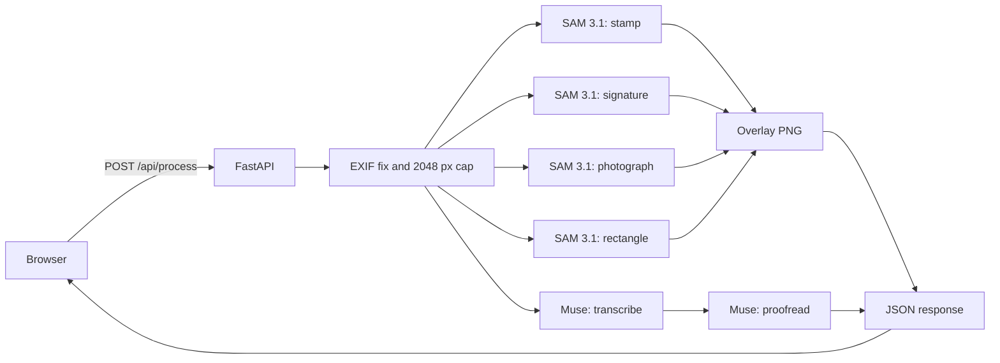

# Document screenshot cleaner

[](https://github.com/vignarajj/dsc_hackathon/actions/workflows/ci.yml)
[](LICENSE)


Upload one screenshot or photo of a page. The app marks the regions you leave on — stamps, signatures, photographs, and rectangles — transcribes the visible text, and proofreads it. You get the original picture, a colored overlay, and the cleaned text beside the transcription, with the edits marked. You can copy that text or download it as Markdown. If a read fails, you can send the same image again.

This is a small tool for a messy real-world image: a photographed form, a handwritten note, a chat, or a phone screen. It was built for the Meta Global AI Developer Hackathon, Indie track, on the theme Build for Your World.

## What you can do

1. Choose or drop a JPEG or PNG up to 10 MB.
2. Leave on the regions you want marked. All four start on.
3. Wait while the image is read. A request can take up to a minute. Press Cancel to stop waiting. The page gives up on its own after 150 seconds. If it fails and the file is still selected, press Try again. That sends the image once more. The API does not retry a call on its own.
4. Compare the original with the overlay. Each kind of region has its own color. Below the pictures, each region you asked for shows how many were found and the best confidence score. Download PNG saves the overlay as `<name>.overlay.png`. Changing the region boxes after a result does not send a new request until you clean again.
5. Read the transcription beside the proofread. Struck-through words were in the transcription. Underlined words are the proofread wording. When nothing changed, the page says so. Copy the cleaned text, or download `<name>.cleaned.md`. Copy and download use the proofread text. They stay off when that text is empty.

An image with no matching regions is still a success. The overlay is the picture with no masks, and the text is whatever was read from the page. If the page has no text, the screen says so and the copy and download buttons stay off.

## What is in this repo

| Path | What it is |
|---|---|
| `backend/` | FastAPI service. Accepts the image, calls the models, and draws the overlay. |
| `frontend/` | Next.js page. Uploads the image and shows the result. |
| `demo/final-demo.webm` | 67 second walkthrough of the polished page, recorded before region choices, the proofread comparison, Try again, Cancel, region counts, and overlay download. |
| `demo/happy-path.webm` | 77 second earlier recording of the first working page. |
| `Document_Screenshot_Cleaner_SAM_Hackathon_Plan.md` | The execution plan and phase tracker. |
| `docs/screenshot.png` | The upload page, shown at the top of this file. |
| `.github/workflows/ci.yml` | Runs the backend and frontend checks on every push and pull request. |

There is no account system, no saved history, and no multi-page document support.

## How one upload is handled



The browser sends the file to `POST /api/process`. The API does not trust the browser to draw masks.

1. It accepts only JPEG or PNG, up to 10 MB. Anything else is HTTP 400. A larger file is HTTP 413.
2. It applies EXIF orientation, then shrinks the long edge to 2048 px when needed. Segmentation, transcription, and the overlay all use that same working image, so the boxes line up with the picture on the page.
3. It asks SAM 3.1, in parallel, for the regions in the `concepts` form field. The known names are `stamp`, `signature`, `photograph`, and `rectangle`, always stored in that order. Omit the field and the server uses `SAM_CONCEPTS`, which defaults to all four. Send the field empty and segmentation is skipped, while transcription still runs. An unknown name is HTTP 400. Prompts for text, a document, or a handwritten note are not sent. Those returned no regions in the early spike. Text comes from a full-image transcription, not from the regions.
4. It decodes each SAM stream with `meta-sam-parser` and paints the mask at the box. A box whose mask cannot be decoded is still outlined. Rectangle fills are lighter than stamps so the words underneath stay readable. Returned boxes are clipped to the working image, and a box entirely off it is dropped.
5. It transcribes the whole image with Muse Spark (`muse-spark-1.3`), then proofreads that text with the same model. The transcription is wrapped in `<transcript>` tags and marked as data, so text in the picture that reads like an instruction does not steer the proofread. An empty transcription is not proofread.
6. Each model call has a 60 second timeout and is not retried by the API. A timeout or an upstream failure is HTTP 502 with a short `detail` string, and the page shows that string. Try again starts a new request with the same file and the regions currently checked.

The response looks like this:

```json
{
  "boxes": [{ "x": 0, "y": 0, "w": 100, "h": 50, "label": "stamp", "score": 0.97 }],
  "overlay_png_base64": "<png with the masks drawn on the working image>",
  "original_text": "<transcription>",
  "cleaned_text": "<proofread text>",
  "models": { "segmentation": "sam-3.1", "transcription": "muse-spark-1.3", "proofread": "muse-spark-1.3" }
}
```

`score` is the model's confidence when it sends one, otherwise `null`. `models` names the models this server is configured to use, and the page prints them under the result. `GET /api/health` returns `{ "status": "ok" }`.

## Requirements

- Python 3.14 and [uv](https://docs.astral.sh/uv/)
- Node.js and pnpm 11
- A Meta Model API key

The key belongs in `backend/.env` only. That file is gitignored.

## Run it locally

From `backend/`:

```bash
cp .env.example .env
# set META_API_KEY
uv sync
uv run uvicorn dsc_backend.main:app --reload --port 8000
```

The process exits on startup if `META_API_KEY` is missing.

From `frontend/`:

```bash
pnpm install
pnpm dev
```

Open http://localhost:3000. The page calls http://127.0.0.1:8000 unless you set `NEXT_PUBLIC_API_BASE_URL` in `frontend/.env.local`. Copy `frontend/.env.example` to change it.

Check the API on its own:

```bash
curl -s http://127.0.0.1:8000/api/health
curl -s -F "image=@note.png;type=image/png" http://127.0.0.1:8000/api/process
```

## Configuration

Optional values in `backend/.env`:

| Name | Default |
|---|---|
| `META_BASE_URL` | `https://api.meta.ai/v1` |
| `SAM_MODEL` | `sam-3.1` |
| `MUSE_VISION_MODEL` | `muse-spark-1.3` |
| `MUSE_TEXT_MODEL` | `muse-spark-1.3` |
| `SAM_CONCEPTS` | `stamp,signature,photograph,rectangle` (used when the request omits `concepts`) |
| `CORS_ORIGINS` | `http://localhost:3000,http://127.0.0.1:3000` |
| `UPSTREAM_TIMEOUT_SECONDS` | `60` |
| `RATE_LIMIT_PER_MINUTE` | `0` (off). Requests per minute per client IP for `/api/process`. Over the limit is HTTP 429. |

`MUSE_TEXT_MODEL` can be set to `muse-wonder-1.0` for the proofread step. The vision step stays on Muse Spark.

## Checks

```bash
cd backend && uv run pytest && uv run ruff check . && uv run ruff format --check .
cd frontend && pnpm test && pnpm lint && pnpm typecheck && pnpm build
```

GitHub Actions runs the same commands on every push and pull request.

Backend tests use a stand-in model client, so they do not spend API credit. The frontend tests cover file checks, error messages, and the Markdown filename. A browser pass of the running app is separate and needs the key.

## Hosting

Nothing in this repo is deployed. Both processes are meant to run on your machine.

A public test needs the API and the page on hosts that can hold a request for about a minute. Put `META_API_KEY` in the API host's environment, not in git. Set `CORS_ORIGINS` to the page's origin, and set `NEXT_PUBLIC_API_BASE_URL` to the API's public URL. The API has no login. Anyone who can reach a public copy can spend the Meta key. Set `RATE_LIMIT_PER_MINUTE` (for example `5`) on a public copy. The limit is kept in memory for one process. Behind a proxy, start uvicorn with `--proxy-headers --forwarded-allow-ips=<proxy IP>` so the limit sees each visitor's address instead of the proxy's. Take the URL down when judging is over.

## More detail

- `backend/README.md` — request rules and the pipeline
- `frontend/README.md` — the upload page
- `Document_Screenshot_Cleaner_SAM_Hackathon_Plan.md` — scope and phase status

## License

MIT. See [LICENSE](LICENSE).
